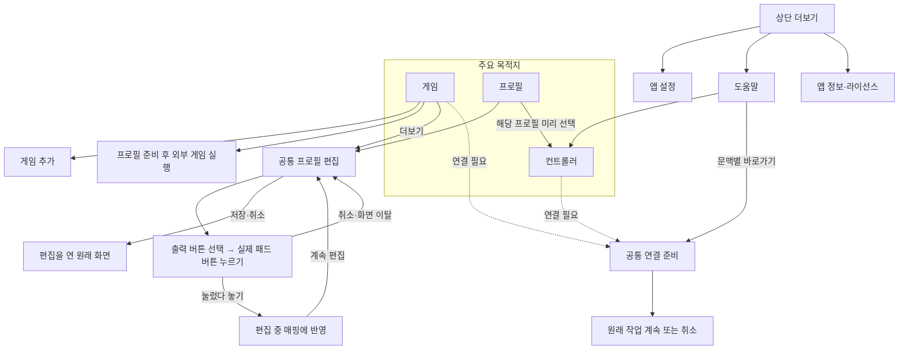
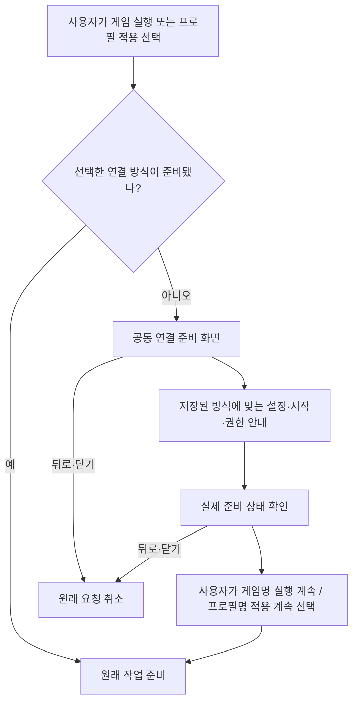

# UI 연결도 · 0.11.0

현재 구현 기준입니다. 화면 이동, 연결 준비 상태, Android 시스템 조작을 서로 다른 그림과 표로 구분합니다.

## 주요 화면

- **게임**: 연결 상태, 조건부 준비·중지, 게임 목록·검색·프로필 선택·실행.
- **컨트롤러**: 장치 이름·ID, 컨트롤러 그림, 동시 입력, 선택한 프로필 적용·중지.
- **프로필**: PS4·PS5·Xbox·Kishi Ultra 공통 프로필 편집과 해당 프로필 테스트.
- **상단 더보기**: 앱 설정, 도움말, 앱 정보·라이선스. 이 화면은 뒤로 돌아갈 원래 목적지를 보존합니다.

좁은 창은 고정 하단 내비게이션, 공간이 충분한 창은 측면 내비게이션을 사용합니다. 제목과 메뉴는 본문 스크롤에 포함되지 않습니다. 짧은 가로 창에는 세 메뉴가 모두 들어가는 하단 배치가 유지될 수 있습니다. 접힘 경계·시스템 바·키보드를 피하는 기하 계산은 공통 소유자가 담당합니다.

게임 카드의 **더보기 → 공통 프로필 편집**과 프로필 목록의 편집은 같은 설정을 수정합니다. 편집 화면에는 현재 게임 목록에서 그 프로필을 쓰는 게임을 표시합니다. 직접 지정 → 기본 프로필 순서의 선택 규칙과 영향 범위를 `GameProfileSelection`에서 함께 소유합니다. 조회되지 않은 명시적 할당은 패키지명을 보존합니다. 미래에 추가되는 게임도 같은 프로필을 사용하면 영향을 받습니다.

## 연결 준비·복구

- 화면을 여는 것만으로 자체 연결↔Shizuku 방식을 바꾸지 않습니다. 변경은 **앱 설정 → 고급 연결 설정**의 명시적 선택에서만 합니다.
- 앱 실행·패드 감지만으로 설정 화면을 강제로 열지 않습니다. 자동 서비스 준비는 이미 권한이 준비된 경우에만 동작합니다.
- 서비스 준비 성공 자체는 게임 실행·프로필 적용 승인이 아닙니다. 계속 버튼과 일치하는 요청 ID·호출자 세대가 필요합니다.
- 뒤로·취소·다른 작업으로 이동하면 이전 의도를 폐기합니다. 오래된 성공·취소 결과는 새 요청을 건드리지 않습니다.
- 재부팅·앱 재실행은 현재 상태를 확인합니다. 저장된 포트나 인증키가 있다는 사실만으로 준비 완료를 표시하지 않습니다.
- Android 설정·알림을 잠깐 사용하는 화면 이탈은 페어링을 유지합니다. 연결 준비 화면 자체를 닫으면 그 화면이 소유한 진행 작업만 취소합니다.
- 알림에서 독립적으로 연 관리 화면에는 원래 게임을 자동 실행할 요청이 없습니다.

## Android 설정·알림 조작

| 단계 | 자체 연결 | Shizuku 선택 시 |
| --- | --- | --- |
| 준비 | Android 무선 디버깅 설정으로 이동 | 설치된 Shizuku 앱 또는 공식 안내 열기 |
| 승인 | 코드 창을 유지한 알림 답장 또는 분할 화면 직접 입력 | Shizuku에서 이 앱의 입력 권한 허용 |
| 시작 | 연결 포트를 입력하고 입력 서비스 시작 | ADB 방식 서버 상태와 권한 확인 |
| 완료 | 실제 서비스 준비 후 명시적 계속 버튼 | shell UID 2000과 권한 확인 후 명시적 계속 버튼 |

페어링 포트와 연결 포트는 서로 다른 입력입니다. 페어링 알림 본문은 관리 화면을 열고, 답장 버튼은 포트·코드를 입력합니다. 분할 화면 입력은 알림을 사용할 수 없는 사용자를 위한 대안으로 유지합니다.

## 상태별 노출

| 상태 | 표시·행동 |
| --- | --- |
| 연결 권한·서비스 준비 부족 | 연결 준비 버튼과 필요한 단계 안내 |
| 패드 없음 | USB·Bluetooth 패드 연결 안내; 게임·프로필 설정은 가능 |
| 서비스 준비됨 | 게임 선택 또는 컨트롤러 적용 |
| 원본 선택 필요 | 실제 서비스가 확인한 원본 목록에서 선택 |
| 입력 세션 사용 중 | 변환 중지 표시 |
| 원래 작업 준비 중 | 취소와 진행 상황 표시 |
| 실패·정리 미완료 | 이유를 표시하고 기존 자원 정리 규칙 유지 |

## 편집과 뒤로 가기

휴대폰에서는 프로필 편집이 전체 안전 영역을 사용하고, 큰 창에서는 너비를 제한합니다. 저장·취소는 고정 헤더에 있으며 폼만 스크롤합니다. 변경 없이 닫으면 바로 복귀하고, 미저장 변경이 있으면 버릴지 확인합니다. 편집 중 회전은 같은 입력 뷰를 유지합니다. 글꼴·밀도 변경에 따른 Activity 재생성까지 미저장 폼 보존을 보장하지는 않습니다.

주메뉴 전환은 게임 실행 요청을 남기지 않습니다. 보조 화면에서 다른 보조 화면으로 이동해도 최초 호출 목적지를 유지합니다. 컨트롤러 화면의 시스템 뒤로는 게임 화면으로 돌아갑니다. 원래 게임에 이미 넘긴 입력 세션은 메뉴를 이동했다고 자동 종료하지 않습니다.

버튼 매핑은 출력 버튼을 먼저 고른 뒤 실제 입력을 받습니다. 수집 화면은 입력 변환이 정리된 상태에서만 장치를 선택하며, 여러 패드가 있으면 사용자가 하나를 고릅니다. 버튼을 눌렀다 놓아야 편집 초안이 바뀌며, 실제 저장은 원래 편집 화면의 저장 버튼에서 합니다. 반복 입력·연결 변경·취소·대기 시간 초과는 매핑을 확정하지 않습니다. 버튼 번호 수동 입력과 원본 버튼 이름을 추측하던 선택 목록은 제거했습니다. 스틱·방향키·트리거와 원본 배치의 디지털 축 입력은 버튼 학습에서 제외하며 기존 자동 판별·고급 설정으로 처리합니다.

## 근거와 검증 대상

- [Android 내비게이션](https://developer.android.com/design/ui/mobile/guides/layout-and-content/layout-and-nav-patterns): 주요 목적지, 문맥별 행동, 창 크기에 따른 배치.
- [Android 설정](https://developer.android.com/design/ui/mobile/guides/patterns/settings): 자주 실행하는 작업과 드문 환경설정의 구분.
- [조건부 내비게이션](https://developer.android.com/guide/navigation/use-graph/conditional): 준비 후 원래 목적지 복귀.
- [Material 대화상자](https://github.com/material-components/material-components-android/blob/master/docs/components/Dialog.md): 복합 편집 작업과 간단한 확인 구분.

위 지침을 이 앱의 작업에 적용한 설계이며, Material 공식 컴포넌트 라이브러리로 앱 전체를 교체한 것은 아닙니다. 실제 폴더블 접힘, 다른 Android 제조사, 새 페어링 전체 과정은 각각 별도 실기 검증이 필요합니다.
